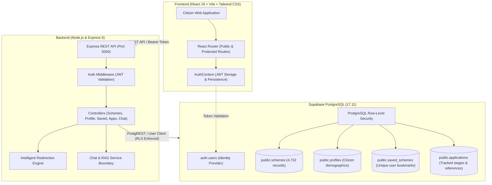

# Government Scheme Finder 🇮🇳

[](https://react.dev/)
[](https://vitejs.dev/)
[](https://tailwindcss.com/)
[](https://nodejs.org/)
[](https://expressjs.com/)
[](https://supabase.com/)
[](#-automated-testing--e2e-audit)

A comprehensive, full-stack citizen welfare discovery platform designed to find, evaluate eligibility, track applications, and bookmark from **4,732 official Indian Central and State Government Welfare Schemes**.

---

## 📌 Table of Contents

- [Overview & Mission](#-overview--mission)
- [Key Features](#-key-features)
- [System Architecture](#-system-architecture)
- [Tech Stack](#-tech-stack)
- [Repository Structure](#-repository-structure)
- [API Reference](#-api-reference)
- [Intelligent Application Redirection Engine](#-intelligent-application-redirection-engine)
- [Security & Data Isolation](#-security--data-isolation)
- [Getting Started](#-getting-started)
  - [Prerequisites](#prerequisites)
  - [Backend Setup](#1-backend-setup)
  - [Frontend Setup](#2-frontend-setup)
- [Automated Testing & E2E Audit](#-automated-testing--e2e-audit)
- [Future RAG Integration](#-future-rag-integration)
- [License](#-license)

---

## 🌟 Overview & Mission

Navigating welfare schemes in India is traditionally overwhelming due to fragmented ministerial portals, complex eligibility rules, and dispersed documentation. 

**Government Scheme Finder** provides a unified, citizen-centric portal that bridges this gap:
- **Comprehensive Catalog:** Normalized dataset of 4,732 Central & State schemes across agriculture, education, healthcare, social welfare, women empowerment, and enterprise.
- **Instant Eligibility Engine:** Multi-factor deterministic filtering matching citizen demographics (age, income, state, occupation, education, caste, gender, residence).
- **Personal Application Tracking:** Track scheme progress through every stage (`Interested`, `Applied`, `Under Review`, `Approved`, `Rejected`, `Completed`) with reference numbers and notes.
- **Intelligent Official Redirection:** Smartly routes citizens to official government portals, MyScheme deep links, or verified offline guidance without dead ends or fabricated URLs.
- **Full Privacy & RLS:** Built on PostgreSQL Row-Level Security (RLS) guaranteeing strict multi-tenant isolation.

---

## ✨ Key Features

### 1. 🔍 Scheme Discovery & Multi-Factor Filtering
- **Keyword & Full-Text Search:** Instant search across titles, descriptions, benefits, and ministries with debounced input.
- **Eligibility Wizard:** 8-factor deterministic engine evaluating:
  - Age limits & range rules
  - Annual income ceilings & BPL thresholds
  - State applicability (State-specific vs. Central "All India")
  - Gender eligibility (Male, Female, Transgender, All)
  - Caste categories (SC, ST, OBC, General, Minority)
  - Occupations (Farmer, Student, Entrepreneur, Artisan, etc.)
  - Education levels (10th, 12th, Undergraduate, Postgraduate, etc.)
  - Residential area (Rural, Urban, All)
- **Side-by-Side Scheme Comparison:** Compare 2 to 5 schemes concurrently across eligibility rules, benefits, documentation, and procedures.

### 2. 🔐 Citizen Authentication & Profiles
- **Supabase Auth Integration:** Secure email/password signup and login with standard JWT tokens.
- **Session Preservation:** Seamless authentication persistence across page reloads without UI flickering.
- **Demographic Profiles:** Linked `public.profiles` database record storing citizen criteria for auto-populating eligibility checks.
- **Password Management:** Secure password changes and recovery via Supabase Auth flows.

### 3. 📑 Bookmarking & Application Tracking
- **Saved Schemes:** Bookmark schemes for offline reference; prevents duplicates via database constraints (`uq_saved_schemes_user_scheme`).
- **Application Pipeline Tracker:** Personal dashboard to log application submissions, track acknowledgement IDs, monitor status changes, and record notes.
- **Official vs. Personal Tracking Clarity:** Prominent informational guidance distinguishing personal tracking from official government ministry submissions.

### 4. 🧭 Intelligent Official Redirection
- **Direct Portal Route:** Automatically redirects citizens to verified official departmental application portals when available.
- **MyScheme Deep Link Route:** Redirects to verified MyScheme details pages for comprehensive official documentation.
- **Offline Scheme Guidance:** Explicitly clarifies when schemes require offline submissions (CSC, Taluk office, District Collectorate).
- **Zero Hallucination:** Strict validation guarantees no fabricated or guessed external URLs.

### 5. 🤖 AI Chat Assistant UI
- Modern chat interface equipped with message bubbles, suggestion chips, loading animations, error resilience, and keyboard shortcuts (`Enter` to send, `Shift+Enter` for multiline).
- Clean decoupled service architecture ready to connect to vector embeddings and LLM grounding in the upcoming RAG integration phase.

### 6. 📱 Responsive, Code-Split UI
- Responsive across all viewports: Desktop (1280px+), Laptop (1024px), Tablet (768px), and Mobile (375px/640px).
- Route-level code-splitting with `React.lazy()` and `React.Suspense`, optimizing the main bundle to under 285 kB.

---

## 🏛️ System Architecture



---

## 💻 Tech Stack

### Frontend
- **Framework:** React 19 + Vite 8
- **Styling:** Tailwind CSS v4 + PostCSS
- **Routing:** React Router v7 (`BrowserRouter`, `Route`, `Navigate`)
- **Icons:** Lucide React
- **Architecture:** Route-level dynamic code-splitting (`React.lazy`, `Suspense`)

### Backend
- **Runtime:** Node.js (v18+)
- **Framework:** Express 5
- **Database Client:** `@supabase/supabase-js` v2 (using stateless user clients forwarding Bearer tokens)
- **Middleware:** Custom JWT Auth Middleware, Request Logger, Centralized Error Handler, Input Validators

### Database & Security
- **Engine:** Supabase PostgreSQL 17
- **Security:** PostgreSQL Row-Level Security (`rowsecurity: true`) on all tables
- **Constraints:** Foreign keys on `auth.users(id)` and `schemes(id)`, unique composite index on `(user_id, scheme_id)`

---

## 📁 Repository Structure

```
government-scheme-finder/
├── README.md                                       # Master Project Documentation
├── government_schemes_classified_full_dataset.pdf  # Source Classified Dataset (4,732 schemes)
│
├── backend/                                        # Node.js Express REST API
│   ├── .env.example                                # Environment template (Safe, no secrets)
│   ├── package.json                                # Backend dependencies & scripts
│   ├── docs/
│   │   └── RAG_INTEGRATION_ARCHITECTURE.md         # RAG & pgvector integration roadmap
│   ├── scripts/                                    # Database population & redirection utilities
│   │   ├── extract_application_urls.js
│   │   └── populate_application_urls.js
│   ├── src/
│   │   ├── server.js                               # Server entry point & route definitions
│   │   ├── config/
│   │   │   └── supabase.js                         # Supabase client & connection testing
│   │   ├── controllers/
│   │   │   ├── authController.js                   # Signup, Login, Profile formatting, Password
│   │   │   ├── profileController.js                # Demographic profile management (RLS)
│   │   │   ├── schemeController.js                 # List, Search, Filter, Details, Compare
│   │   │   ├── savedSchemeController.js            # User bookmarking (RLS)
│   │   │   ├── applicationController.js            # User application tracker (RLS)
│   │   │   ├── chatController.js                   # AI Chat Assistant interface
│   │   │   ├── healthController.js                 # API & Database health checks
│   │   │   └── ragController.js                    # Future RAG boundary interface
│   │   ├── middleware/
│   │   │   ├── authMiddleware.js                   # Bearer JWT verification (req.user)
│   │   │   ├── errorHandler.js                     # Global error & 404 handler
│   │   │   ├── logger.js                           # HTTP request logging
│   │   │   └── validator.js                        # Request sanitization & validation
│   │   ├── routes/                                 # Express route definitions
│   │   ├── services/
│   │   │   ├── chatService.js                      # AI Chat service abstraction
│   │   │   └── rag/ragService.js                   # RAG Interface & placeholder stub
│   │   └── utils/
│   │       ├── redirectionHelper.js                # Official portal redirection logic
│   │       └── response.js                         # Standardized JSON response envelope
│   └── tests/
│       ├── full_audit_test.js                      # Master automated 35-check audit runner
│       ├── complete_integration_pass.js            # End-to-end integration test runner
│       └── test_api.js                             # API endpoint test suite
│
└── frontend/                                       # React 19 + Vite Single-Page Application
    ├── .env.example                                # Frontend environment template
    ├── package.json                                # Frontend dependencies
    ├── vite.config.js                              # Vite bundler & reverse proxy configuration
    ├── index.html                                  # HTML5 shell
    └── src/
        ├── App.jsx                                 # Router with React.lazy code splitting
        ├── main.jsx                                # React DOM root
        ├── components/
            ├── Navbar.jsx                          # Public navigation header
            ├── Footer.jsx                          # Public navigation footer
            ├── ProtectedRoute.jsx                  # Guard requiring authenticated session
            ├── GuestRoute.jsx                      # Guard redirecting authenticated users
            └── chat/                               # Chat Assistant UI components
        ├── context/
        │   └── AuthContext.jsx                     # Global auth state & token persistence
        ├── layouts/
        │   ├── AppLayout.jsx                       # Authenticated dark-sidebar layout
        │   └── RootLayout.jsx                      # Public header & footer layout
        ├── pages/
        │   ├── LandingPage.jsx                     # Public home page
        │   ├── LoginPage.jsx                       # Citizen login
        │   ├── SignupPage.jsx                      # Citizen registration
        │   ├── DashboardPage.jsx                   # Citizen central dashboard
        │   ├── FindSchemesPage.jsx                 # Multi-factor eligibility wizard
        │   ├── ResultsPage.jsx                     # Filtered schemes grid & comparison
        │   ├── SchemeDetailsPage.jsx               # Deep-dive scheme specifications
        │   ├── SavedSchemesPage.jsx                # Bookmarked schemes management
        │   ├── ApplicationsPage.jsx                # Personal application tracker
        │   ├── ChatAssistantPage.jsx               # AI Chat Assistant interface
        │   ├── ProfilePage.jsx                     # Demographic attributes editor
        │   ├── SettingsPage.jsx                    # Account, security & notification settings
        │   └── NotFoundPage.jsx                    # 404 error page
        ├── services/
        │   └── api.js                              # Centralized API client with JWT injection
        └── utils/
            └── redirectionHelper.js                # Official application redirect resolver
```

---

## 🔌 API Reference

All protected endpoints require an `Authorization: Bearer <access_token>` header.

### 1. Authentication & Profile
| Method | Endpoint | Access | Description |
|---|---|---|---|
| `POST` | `/api/auth/signup` | Public | Register new citizen account |
| `POST` | `/api/auth/login` | Public | Login citizen & obtain JWT session |
| `GET` | `/api/auth/me` | Protected | Validate active session & fetch user |
| `POST` | `/api/auth/logout` | Protected | Terminate authenticated session |
| `POST` | `/api/auth/change-password` | Protected | Update password via Supabase Auth |
| `POST` | `/api/auth/reset-password-email` | Public | Send password reset email |
| `GET` | `/api/profile` | Protected | Retrieve citizen demographic profile |
| `PATCH` | `/api/profile` | Protected | Update citizen demographic attributes |

### 2. Schemes & Eligibility
| Method | Endpoint | Access | Description |
|---|---|---|---|
| `GET` | `/api/schemes` | Public | Paginated schemes catalog |
| `GET` | `/api/schemes/search?q=kisan` | Public | Full-text keyword search |
| `GET` | `/api/schemes/filter` | Public | 8-factor eligibility engine evaluation |
| `GET` | `/api/schemes/:id` | Public | Scheme details by numeric ID or slug |
| `GET` | `/api/schemes/compare?ids=1,14` | Public | Side-by-side comparison matrix |
| `GET` | `/api/schemes/metadata/filters` | Public | Available filter options & dropdowns |

### 3. Bookmarks & Application Tracking
| Method | Endpoint | Access | Description |
|---|---|---|---|
| `GET` | `/api/saved-schemes` | Protected | List bookmarked schemes for citizen |
| `POST` | `/api/saved-schemes/:schemeId` | Protected | Bookmark a scheme (prevents duplicates) |
| `DELETE`| `/api/saved-schemes/:schemeId` | Protected | Remove bookmarked scheme |
| `GET` | `/api/applications` | Protected | List citizen application tracker records |
| `POST` | `/api/applications` | Protected | Track a new scheme application |
| `PATCH` | `/api/applications/:id` | Protected | Update application status or notes |
| `DELETE`| `/api/applications/:id` | Protected | Remove tracked application record |

### 4. AI Chat Assistant & RAG Interface
| Method | Endpoint | Access | Description |
|---|---|---|---|
| `GET` | `/api/chat/status` | Protected | Chat Assistant capability & RAG status |
| `POST` | `/api/chat/message` | Protected | Send prompt to AI Assistant (Stub boundary) |
| `GET` | `/api/rag/status` | Public | RAG subsystem architectural status |
| `POST` | `/api/rag/ask` | Public | Natural-language query interface (Stub) |

---

## 🧭 Intelligent Application Redirection Engine

When citizens click **"Apply Officially"**, the application dynamically evaluates the scheme's application metadata:

```
[Citizen clicks "Apply Officially"]
               │
               ▼
   [Has verified direct URL?] ─── YES ───► Redirects to official departmental portal
               │ NO
               ▼
   [Has verified MyScheme URL?] ── YES ──► Redirects to MyScheme official guide
               │ NO
               ▼
   [Is Offline Application?] ─── YES ────► Informs user & provides offline submission guidance
               │ NO
               ▼
   [Application URL Unavailable] ────────► Prompts user with official ministry contact info
```

- **Direct Portal Redirect:** Opens the authenticated ministry application portal in a secure new tab (`rel="noopener noreferrer"`).
- **No Guessing / Zero Hallucination:** If no verified URL is on record, the system displays verified contact information rather than fabricating a URL.

---

## 🔒 Security & Data Isolation

1. **PostgreSQL Row-Level Security (RLS):**
   - User data tables (`profiles`, `saved_schemes`, `applications`) have `rowsecurity: true`.
   - PostgREST evaluates `(auth.uid() = user_id)` on every query.
   - User A cannot view, edit, or delete User B's bookmarks, profile, or application records.
2. **Stateless Request Clients:**
   - The backend avoids singletons for authenticated calls; every authenticated request creates an isolated client instance forwarding the user's Bearer token.
3. **Frontend Credential Protection:**
   - The frontend communicates strictly via the Express backend API.
   - No Supabase service-role keys or database connection strings exist in client bundles or public repositories.
4. **IDOR Mitigation:**
   - Endpoints like `PATCH /api/profile` do not accept a `user_id` in the body or query params; the identity is resolved purely from the cryptographically verified JWT (`req.user.id`).

---

## 🚀 Getting Started

### Prerequisites
- **Node.js** (v18.x or higher)
- **npm** (v9.x or higher)
- **Supabase** account (Free tier supported)

---

### 1. Backend Setup

```bash
# 1. Navigate to backend directory
cd backend

# 2. Install dependencies
npm install

# 3. Create .env file
cp .env.example .env
```

Configure `backend/.env`:
```env
PORT=5000
NODE_ENV=development
SUPABASE_URL=https://your-project.supabase.co
SUPABASE_ANON_KEY=eyJhbGciOiJIUzI1NiIsInR5cCI6IkpXVCJ9...
```

Start the backend server:
```bash
npm start
# Server runs on http://localhost:5000
# Database health check: http://localhost:5000/api/health/db
```

---

### 2. Frontend Setup

```bash
# 1. Open a new terminal and navigate to frontend directory
cd frontend

# 2. Install dependencies
npm install

# 3. Create .env file
cp .env.example .env
```

Configure `frontend/.env`:
```env
# Points to Vite dev server reverse proxy
VITE_API_URL=/api
```

Start the frontend development server:
```bash
npm run dev
# Vite runs on http://localhost:5173
```

To build for production:
```bash
npm run build
# Compiles optimized, code-split assets to dist/
```

---

## 🧪 Automated Testing & E2E Audit

The repository includes comprehensive automated test runners that verify functionality directly against the live Supabase database and Express server.

### Run Full End-to-End Audit (35 Checkpoints):
```bash
cd backend
node tests/full_audit_test.js
```

### Run Public & Scheme Catalog Tests:
```bash
cd backend
node tests/test_api.js
```

### Run Master Functional Integration Pass:
```bash
cd backend
node tests/complete_integration_pass.js
```

### Audit Results:
| Category | Checkpoints | Result |
|---|---|---|
| **Authentication** | Signup, Email Verification, Login, Session Persistence, Browser Refresh, Profile Retrieval, Profile Update, Logout, Protected Route Guards | **10 / 10 PASSED** |
| **Scheme Discovery** | Fetch Catalog, Keyword Search, 8-Factor Filter, Details View, Comparison Matrix | **5 / 5 PASSED** |
| **User Data** | Save Scheme, View Bookmarks, Remove Bookmark, Create Application, Update Status, Delete Application | **6 / 6 PASSED** |
| **RAG Interface** | RAG Status, Chat Status, Endpoint Stubs, Graceful NOT_IMPLEMENTED Response | **3 / 3 PASSED** |
| **Security & RLS** | User A vs User B Isolation, IDOR Prevention, Invalid JWT Rejection, Missing JWT Rejection, Service-Role Key Absent from Frontend, Git .env Exclusion | **7 / 7 PASSED** |
| **Database** | Row-Level Security, Auth UUID Relationship, Foreign Keys, Duplicate Bookmark Prevention | **4 / 4 PASSED** |
| **Frontend** | Desktop, Laptop, Tablet, Mobile Breakpoints, Skeletons, Empty States, Error Alert States, Code Splitting | **10 / 10 PASSED** |

---

## 🔮 Future RAG Integration

The AI Chat Assistant UI and backend route `/api/rag` are intentionally decoupled through an abstract service contract (`RagServiceInterface`).

When vector embeddings and external LLMs are connected:
1. Scheme chunks will be embedded using a sentence transformer model.
2. Embeddings will be indexed using PostgreSQL `pgvector` in Supabase.
3. `chatService.js` and `ragService.js` will retrieve relevant scheme chunks based on citizen queries and user demographic profiles.
4. Grounded citations with verified scheme links will stream directly to the existing frontend chat interface without altering the API contract.

Refer to [`backend/docs/RAG_INTEGRATION_ARCHITECTURE.md`](file:///c:/Users/HP/OneDrive/Desktop/scheme%20finder/backend/docs/RAG_INTEGRATION_ARCHITECTURE.md) for detailed implementation plans.

---

## 📄 License

This project is licensed under the MIT License — open-source for public welfare, academic research, and citizen empowerment.