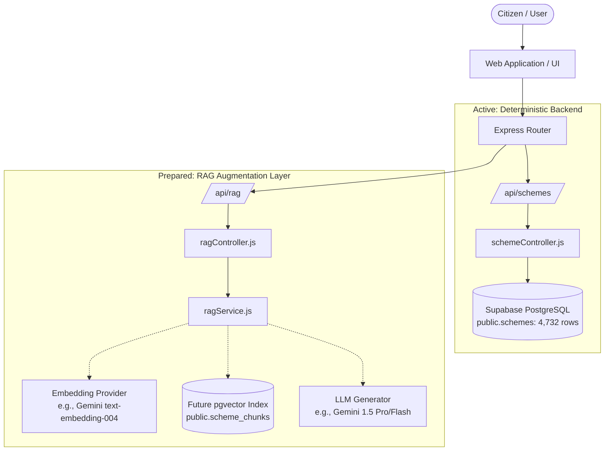

# Government Scheme Finder - Future RAG Integration Architecture

## 1. Overview & Architectural Boundaries

The **Government Scheme Finder** is architected with a strict separation between:
1. **Deterministic Database Services (Active):** High-speed SQL search, faceted eligibility filtering, comparison matrices, and pagination over the 4,732 schemes stored in Supabase PostgreSQL.
2. **Retrieval-Augmented Generation (RAG) Layer (Interface Prepared):** Future semantic search, natural-language Q&A, and context-grounded AI responses.

### Guiding Principles
* **Zero Disruption to Core APIs:** Traditional REST endpoints (`/api/schemes`, `/api/schemes/filter`, `/api/schemes/search`, etc.) operate completely independently of the RAG subsystem.
* **Database-First Integrity:** Ground truth always resides in PostgreSQL `public.schemes`. RAG is an augmentation layer for comprehension and semantic exploration, not a replacement for rule-based eligibility checks.
* **Decoupled Service Interface:** The application accesses RAG features strictly through `RagServiceInterface` located at `backend/src/services/rag/ragService.js`. When RAG is inactive, safe stub responses are returned with suggested traditional search links.

---

## 2. System Architecture Flow



---

## 3. Data Foundation & Text Chunking Strategy

The `public.schemes` table already holds structured text for all 4,732 schemes. When generating chunks for RAG, each scheme should be split into 2 to 3 contextual chunks to preserve semantic density without exceeding token limits.

### Text Sources from `public.schemes`
| Field in `public.schemes` | Target Chunk Type | Description |
|---|---|---|
| `scheme_name`, `brief_description`, `benefits` | **Overview Chunk** | High-level purpose and financial/in-kind benefits. |
| `eligibility_criteria`, `exclusions`, `min_age`, `max_age`, `max_income` | **Eligibility Chunk** | Specific demographic and socioeconomic requirements. |
| `application_process`, `documents_required` | **Application Chunk** | How to apply and necessary documents (Aadhaar, income certificate, etc.). |

### Proposed Chunk Metadata Payload
Each chunk in the vector store should carry structured metadata to enable **Hybrid Pre-filtering**:
```json
{
  "scheme_id": 142,
  "chunk_index": 1,
  "chunk_type": "eligibility",
  "scheme_name": "Mukhyamantri Amrutum Yojana",
  "state": "Gujarat",
  "category": "Health & Family Welfare",
  "gender_applicability": "All",
  "min_age": null,
  "max_age": null,
  "max_income": 400000
}
```

---

## 4. Supabase Vector Storage Design (Future)

When RAG is ready to be enabled, the `pgvector` extension will be activated in Supabase.

### Proposed Table Schema: `public.scheme_chunks`
```sql
-- 1. Enable pgvector extension
CREATE EXTENSION IF NOT EXISTS vector;

-- 2. Create chunks table
CREATE TABLE IF NOT EXISTS public.scheme_chunks (
    id BIGSERIAL PRIMARY KEY,
    scheme_id INTEGER NOT NULL REFERENCES public.schemes(id) ON DELETE CASCADE,
    chunk_index INTEGER NOT NULL,
    chunk_type VARCHAR(32) NOT NULL, -- 'overview', 'eligibility', 'process'
    content TEXT NOT NULL,
    metadata JSONB DEFAULT '{}'::jsonb,
    embedding vector(768), -- 768 for Gemini text-embedding-004; 1536 for OpenAI
    created_at TIMESTAMPTZ DEFAULT NOW()
);

-- 3. Create HNSW index for fast Cosine Distance similarity search
CREATE INDEX IF NOT EXISTS idx_scheme_chunks_embedding_hnsw 
ON public.scheme_chunks 
USING hnsw (embedding vector_cosine_ops);

-- 4. Create index on scheme_id for relational joins
CREATE INDEX IF NOT EXISTS idx_scheme_chunks_scheme_id 
ON public.scheme_chunks(scheme_id);
```

---

## 5. Hybrid Retrieval & Grounded Q&A Pipeline

The future pipeline utilizes a **Hybrid Retrieval** model combining SQL hard filters with vector similarity:

```
Step 1: Citizen Query + Profile (Age: 21, State: "Gujarat", Student)
              ↓
Step 2: Hard Pre-filter (PostgreSQL SQL):
        WHERE (state = 'Gujarat' OR state = 'All')
              ↓
Step 3: Vector Similarity Search (pgvector):
        ORDER BY embedding <=> query_embedding LIMIT 10
              ↓
Step 4: Context Assembly:
        Combine top-5 matched chunks with citations (Scheme ID, Title, Official Link)
              ↓
Step 5: Grounded LLM Generation (Strict anti-hallucination prompt)
              ↓
Step 6: Citizen Response with exact Scheme citations
```

### Prompt Engineering Template (Anti-Hallucination)
```text
System: You are an official Indian Government Welfare Scheme Advisor.
You only provide advice grounded strictly in the provided Context.
Never invent schemes, eligibility criteria, or monetary amounts.
If the information is not present in the context, explicitly state:
"I could not find a scheme matching those exact details in the verified catalog."
Always cite the Scheme Name and Scheme ID for every recommendation.

Context:
[Source 1: ID 104 - Post Matric Scholarship for OBC Students, Gujarat]
...
[Source 2: ID 412 - MYSY Mukhyamantri Yuva Swavalamban Yojana]
...

Citizen Profile:
Age: 21, State: Gujarat, Category: Student, Income: 2,00,000 INR

Citizen Question:
Can I get a scholarship for college fees?
```

---

## 6. Backend API Module Boundary

The backend exposes 4 endpoints under `/api/rag`:

| Endpoint | Method | Status | Purpose |
|---|---|---|---|
| `/api/rag/status` | `GET` | **Active (Reports Status)** | Checks if RAG provider and vector store are ready. |
| `/api/rag/ask` | `POST` | **Interface Ready (Stub)** | Natural-language scheme Q&A with citizen profile context. |
| `/api/rag/semantic-search` | `POST` | **Interface Ready (Stub)** | Vector similarity search over scheme catalog. |
| `/api/rag/context` | `POST` | **Interface Ready (Stub)** | Retrieves raw text chunks for external grounding. |

### Sample Response from `/api/rag/status`
```json
{
  "success": true,
  "message": "RAG layer status retrieved successfully",
  "data": {
    "isReady": false,
    "provider": "none",
    "vectorStore": "none",
    "message": "RAG subsystem interface is prepared but unimplemented. Database-first filtering and standard REST APIs are active and operating independently.",
    "capabilities": {
      "naturalLanguageQnA": false,
      "semanticSearch": false,
      "hybridFiltering": false
    },
    "futureIntegrationGuide": "/docs/RAG_INTEGRATION_ARCHITECTURE.md"
  }
}
```

---

## 7. Future Activation Checklist

When ready to implement RAG:
1. **Enable pgvector:** Run `CREATE EXTENSION IF NOT EXISTS vector;` in Supabase.
2. **Create chunk table:** Run the schema defined in Section 4.
3. **Run Chunking & Embedding Script:** Batch iterate over `public.schemes` (1 to 4,732), generate embeddings using Gemini or OpenAI, and insert into `public.scheme_chunks`.
4. **Implement Service Provider:** Create `backend/src/services/rag/geminiRagService.js` implementing `RagServiceInterface`.
5. **Switch Provider in Configuration:** Set `RAG_PROVIDER=gemini` and `RAG_VECTOR_STORE=pgvector` in `.env`.
